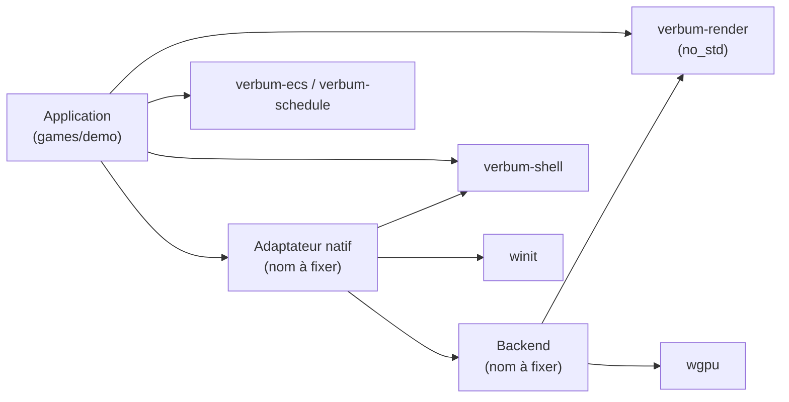
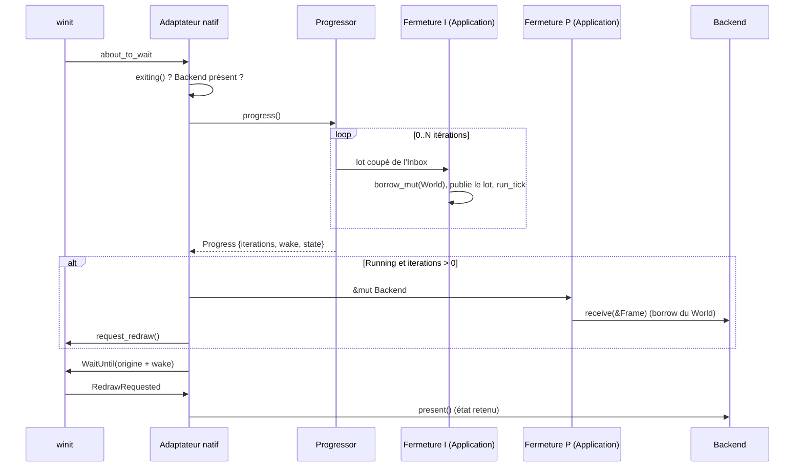

# Investigation du contrat de plateforme native (winit + wgpu) — dossier consolidé

## Statut

**Note historique et explicative. Non normative.** Date : 25 novembre 2026.

Ce document retrace une investigation menée avant la spécification d'un crate de plateforme native (adaptateur winit et Backend wgpu), puis de `demo-0`. Il ne remplace aucun ADR, n'introduit aucun invariant et ne modifie aucun document existant. Les ADR adoptés et les documents fondateurs font autorité ; lorsqu'une phrase ci-dessous diffère d'eux, ils priment.

Les décisions qu'il consigne se répartissent en quatre statuts (cf. § 5) : *ADR adopté*, *arbitrage complémentaire*, *orientation d'implémentation*, *rejeté*, *ouvert*. Aucune décision n'est attribuée rétroactivement à un ADR qui ne la contenait pas.

### Légende de provenance

| Étiquette | Sens |
|---|---|
| **[Fondateur]** | `00-principes.md`, `01-runtime-ecs.md`, `02-concepts.md` (normatifs) |
| **[ADR]** | clause d'un ADR adopté |
| **[Note]** | document non normatif du dépôt (`technology-selection-note.md`, pages d'axes) |
| **[Rapport]** | note de vérification issue de la première session d'investigation (non relue à la source) |
| **[Code]** | fichier du dépôt dont un extrait a été fourni à Claude |
| **[Dépôt]** | commande exécutée par l'utilisateur dans le dépôt réel, résultat communiqué |
| **[Stub]** | contrôle de type compilé dans un projet temporaire hors dépôt |
| **[Source]** | code source d'une dépendance externe lu dans le registre Cargo |
| **[Arbitrage]** | décision de l'utilisateur pendant l'investigation |
| **[Interprétation]** | lecture de l'investigation, non normative |

---

## 1. Contexte et périmètre

### 1.1 Objectif initial et suspension de Demo-0

L'objectif initial était `demo-0` : une fenêtre native, un fond `#333333` et un carré `#FF8C00`, décrit par `docs/implementation/07-verbum-demo-0.md`. Sa spécification a été **suspendue** afin d'établir d'abord le contrat de la plateforme native : qui crée la fenêtre, qui possède le Backend, comment une `Frame` passe du `World` au Backend, comment la boucle winit s'articule avec le `Progressor`. Le but final est la rédaction d'une spécification pour un crate de plateforme (adaptateur et Backend), puis, plus tard, pour `demo-0`.

### 1.2 Versions de référence

| Élément | Version | Provenance |
|---|---|---|
| winit | 0.30.13 | [Note] `technology-selection-note.md` ; [Stub], [Source] |
| wgpu | 30.0.1 | [Note] ; [Stub], [Source] |
| raw-window-handle | 0.6.2 | [Note] ; [Stub] (version unique dans l'arbre) |
| Rust du workspace | 1.100 | [Arbitrage] ; [Rapport] |

Les contrôles [Stub] ont été compilés avec **rustc/cargo 1.97.0**, non 1.100. Aucun contrôle de MSRV n'a été fait. wgpu 30.0.2 existe ; les stubs fixaient `=30.0.1`.

### 1.3 Périmètre investigué

- La transmission de la `Frame` (réception / présentation).
- La propriété du `World` en composition applicative.
- La topologie de crates (Backend séparé de winit).
- La couture `Arc<Window>` → `Surface<'static>`.
- Le cycle de vie natif minimal : création du Backend, première progression, redessin.
- Le chemin d'arrêt et le rôle de l'horloge.
- Le modèle de composition : qui compose quoi (Shell, Application, `World`).

### 1.4 Explicitement laissé ouvert

La politique temporelle de S04 (valeurs de q, K, M), l'exécuteur du `request_adapter` / `request_device`, la politique fine de redessin, le catalogue d'événements, les capacités `Frame`, le nom et l'emplacement de l'application, le cycle de vie général des infrastructures (futur périmètre d'ADR-S05). Détail au § 5.

---

## 2. Sources et hiérarchie

### 2.1 Ce qui fait autorité

1. **Documents fondateurs [Fondateur]** : `00-principes.md`, `01-runtime-ecs.md`, `02-concepts.md`.
2. **ADR adoptés [ADR]** lus pendant la seconde session : ADR-000, R03, S01, S02, S04, W01.
3. **Non lus à la source dans cette investigation** : ADR-S03, ADR-R02, ADR-R01 (leurs clauses ne sont citées que via d'autres textes ou via [Rapport]).

### 2.2 Ce qui n'a aucune autorité normative

- **Notes [Note]** : `technology-selection-note.md` (versions) ; pages d'axes (`page-axes-shell-boucle-presentation.md`, `page-axes-shell-s-temporal-policy.md`), non relues dans la seconde session.
- **Rapports d'investigation** : [Rapport] (première session, saturée) ; notes de vérification de la seconde session. Les premières étapes de l'historique (§ 3, étapes 1 à 4) sont reconstruites à partir de ce rapport et des consignes de l'utilisateur, non observées directement.
- **Code consulté [Code]** : `crates/engine/shell/src/{progressor,clock,shell,lib}.rs`, `crates/engine/shell/tests/temporal_drivers.rs`, `crates/engine/render/{Cargo.toml,src/lib.rs}`, `representation.rs` (version fournie), `tree.md` (arborescence au 22 novembre 2026).
- **Résultats de commandes [Dépôt]** : `cargo test -p verbum-render -- --list` ; `grep` sur `progressor.rs` ; `ls` de `render/src` et `render/tests` ; état vert communiqué après replacement de `representation.rs` (§ 6).
- **Prototypes [Stub]** : quatre projets temporaires hors dépôt, compilés (`cargo check`), non exécutés : couture wgpu/winit, cas négatif sans `rwh_06`, câblage G1 avec `Progressor` simplifié, câblage des formes A, A′ et B avec la signature réelle du `Progressor` (stubs pour `Inbox`, `TemporalPolicy`, `Backend`, `World`).
- **Documentation et sources externes [Source]** : sources de winit 0.30.13, wgpu 30.0.1 et raw-window-handle 0.6.2 dans le registre Cargo. docs.rs n'a été consulté que dans la première session ([Rapport]).

---

## 3. Historique raisonné de l'investigation

### 3.1 État initial du Shell et du Renderer

- Le Shell [Code] est piloté par des fermetures. Il n'a aucune dépendance, ne nomme aucun type du noyau et expose `run_loop`, `run_blocking`, `Inbox`, `MonotonicClock`, `TemporalPolicy` et `Progressor`.
- Le `Progressor<Ev: Copy, E, C, S, I>` possède politique, horloge `C`, arrêt `S`, `Inbox` et fermeture d'infrastructure `I`. Une progression exécute 0..K itérations par le cœur `iterate` (arrêt, coupure, invocation) [Code].
- Le Renderer [Code] est `no_std`, sans allocation. Il fournit `Contribution`, `Contributions<CAP>` et `Frame<CAP>` ; la composition de la `Frame` est un système.
- Aucun Backend n'existe. S01 pt 5 pose le schéma « 0..N itérations puis 0..1 `FrameRepresentation` transmise » [ADR] ; S02 pt 12 et S04 pt 12 renvoient la transmission à « ADR-R03 / ADR-S05 éventuelle » [ADR].

### 3.2 Propriété et cardinalité de la `Frame`

- Le `Progressor::progress(&mut self)` possède la fermeture `I`, qui possède (ou capture) le `World`. Après la progression, l'application ne peut donc pas lire la `Frame` dans le `World` sans partage ou restitution [Rapport ; confirmé par S02 pt 10 et `progressor.rs`].
- Rien ne signale la dernière itération d'une progression : remettre la `Frame` depuis la fermeture reviendrait à une remise par itération.
- ADR-R03 pt 3 décrit le point d'invocation du Backend « à la fin de la phase d'Extraction (…) un point d'entrée unique, hors du système de contrats », sans définir « transmission » ni la cardinalité par rapport à N itérations [ADR].

### 3.3 Réception et présentation

- **Réception** : remise d'une nouvelle représentation à l'état du Backend. **Présentation** : exécution graphique de l'état retenu, répétable sans nouvelle réception [Arbitrage].
- L'invariant « 0..1 » de S01 pt 5 porte sur les réceptions [Arbitrage]. Aucun ADR ne l'interdit [Interprétation] : R03 pt 2 dit que le Backend « applique la représentation qu'il reçoit » sans borner le nombre d'applications.
- La détection de changement par comparaison de `Frame`s est abandonnée : après une progression `Running` avec `iterations > 0`, la `Frame` finale est reçue et un redessin est demandé [Arbitrage].

### 3.4 Abandon de C1, choix de l'extraction post-progress

- **C1** (copier la `Frame` dans un puits à chaque itération) est **rejetée** : elle produit K réceptions, contraire à « 0..1 », et copie `Frame<CAP>` à chaque itération [Arbitrage].
- **Extraction post-progress** : après `progress()`, l'application lit la `Frame` finale et la remet au plus une fois au Backend, qui la convertit en état de présentation persistant. Aucune copie intégrale de `Frame<CAP>` n'est faite : le Backend lit `&Frame` et convertit dans un tampon préalloué [Arbitrage ; Rapport pour le coût].

### 3.5 Propriété du `World` : `Rc<RefCell<World>>`

- Mécanisme retenu : la fermeture d'itération fait `borrow_mut()` du `World` ; après `progress()`, la fermeture de publication fait `borrow()` pour lire la `Frame`. Les emprunts sont strictement séquentiels (S02 pt 4 : non réentrance ; pt 9 : monothread). Un chevauchement serait un bug d'assemblage et paniquerait.
- **ADR-000 pt 3** [ADR] : « Cette ADR exige seulement que les données qui franchissent la frontière ne contiennent ni propriété partagée ni référence à un type de la Plateforme. » La règle vise les données franchissant la frontière, non la composition applicative. `&Frame` est un emprunt temporaire ; `Frame` ne contient que des types plats [Code]. L'`Rc` est alloué une fois à l'assemblage, hors du graphe d'appel de `world.execute()` [Interprétation].
- Contrainte [Arbitrage] : ce mécanisme ne devient ni API du Shell, ni du Scheduler, ni du noyau ECS.

### 3.6 Séparation G1

- Orientation retenue : le Backend dépend de `verbum-render` et de wgpu seulement ; l'adaptateur natif dépend du Shell, du Backend et de winit. Aucun trait générique de Backend (R03 pt 4 : le choix de la bibliothèque de rendu est hors modèle) [Arbitrage].
- Le Backend ne peut pas être `verbum-render` lui-même : ce crate est `no_std` sans `alloc` [Code], sous ADR-000 pt 4.
- **Historique G2 / G1.** Les éléments suivants proviennent de la première investigation, tels que l'utilisateur les a communiqués dans la conversation ; le rapport original n'a pas été relu.
  - **G2** : un seul crate Engine `platform`, réunissant l'adaptateur natif winit, le Backend wgpu et le `FrameSink`. Il dépend de `verbum-shell`, `verbum-render`, winit et wgpu.
  - **G1** : deux crates séparés, un adaptateur natif et un Backend graphique. L'adaptateur dépend du Shell, de winit et du Backend ; le Backend dépend de `verbum-render` et de wgpu.
  - **Première recommandation : G2**, notamment parce qu'elle évitait une interface inter-crates de Backend.
  - **Réexamen dans la seconde investigation** : une interface `pub` entre deux crates n'est pas nécessairement une API publique stable destinée aux applications ; G1 matérialise dans le graphe de dépendances l'impossibilité pour le Backend de nommer winit ou le Shell ; les responsabilités de cycle de vie événementiel et de présentation graphique justifient deux frontières distinctes.
  - **Arbitrage final : G1 retenue** [Arbitrage]. G2, recommandée à l'origine, est écartée.

### 3.7 Couture wgpu / winit

Résultats [Stub] avec winit 0.30.13, wgpu 30.0.1, raw-window-handle 0.6.2 :

- `Instance::create_surface(arc_window)` avec `Arc<Window>` donne une `Surface<'static>` : **compile**.
- Une cible nommée uniquement par `wgpu::rwh::HasWindowHandle + HasDisplayHandle + WasmNotSendSync + 'static` : **compile**.
- Un Backend qui conserve `Arc<dyn wgpu::DisplayAndWindowHandle>` et recrée la surface par `create_surface(target.clone())` : **compile** (types seulement). Le trait est défini dans wgpu (`WindowHandle + HasDisplayHandle`, impl générique) [Source].
- Sans la feature `rwh_06` de winit : **échec** (`Window: HasWindowHandle` et `HasDisplayHandle` non satisfaits). Elle fait partie des features par défaut de winit 0.30.13 [Source].
- `alloc` de raw-window-handle (impl `Arc<H>`) est activée par la feature `std` de wgpu ; aucune dépendance directe à `raw-window-handle` n'est nécessaire (`wgpu::rwh`). Version unique dans l'arbre : 0.6.2.
- Ordre de destruction : le Backend détient un clone de la cible ; la surface doit tomber avant le Device (ordre des champs) [Interprétation].

Seulement documenté ([Rapport], non revérifié) : panique de la création de surface sur macOS hors thread principal ; panique de `Surface::configure` à taille nulle ; traitement des statuts `CurrentSurfaceTexture`.

### 3.8 Initialisation et cycle de vie natif

- Le Backend est créé dans `resumed`, avec un **état de présentation vide** (aucune instance, clear `#333333`, présentable immédiatement). Aucune `Frame::empty()` n'est transmise à la création : la première réception suit une progression `Running` ayant achevé au moins une itération [Arbitrage]. S02 pt 8 [ADR] signale déjà qu'un redessin peut utiliser « la représentation précédemment retenue ».
- Ordre winit [Source, **X11 et Wayland seulement**] : `single_iteration(Init)` émet `NewEvents`, puis `Resumed`, puis traite les événements, `AboutToWait` étant « toujours le dernier événement dispatché avant le poll suivant ». La documentation de winit garantit seulement que `Resumed` suit `NewEvents(Init)` et recommande d'y créer fenêtre et contexte graphique.
- Conséquence retenue [Interprétation] : l'adaptateur ne rappelle `progress()` que si le Backend existe, sans stockage de `Frame` intermédiaire. Si une progression survenait avant le Backend, la `Frame` serait perdue ; la perte serait transitoire, car S04 pt 8 garantit une prochaine échéance hors état terminal et les itérations se poursuivent.

### 3.9 Arrêt et horloge

- **Correction d'arbitrage** : `CloseRequested` ne doit pas provoquer directement `exit()`. S02 pt 7 [ADR] : une demande d'arrêt formulée par la Plateforme, « via un moyen fourni par le Shell et indépendant de tout type de fenêtrage », est observée avant la coupure de la prochaine itération [Arbitrage].
- Mécanisme réel [Code] : la demande d'arrêt est la fermeture `S: FnMut() -> bool`, passée à `iterate` ; elle n'est pas un handle. Les tests partagent l'état par `Rc<Cell<…>>`. L'arrêt est observé avant toute coupure (`shell.rs` : `if stop() { return Iteration::Stopped; }`), la boîte reste intacte [Code : `iterate` ; test `e1`].
- Séquence retenue [Arbitrage] : `CloseRequested` lève un drapeau `Rc<Cell<bool>>` ; le `about_to_wait` suivant appelle `progress()` ; `Stopped` provoque `exit()` ; `Failed` appelle `take_error()` (une seule fois) puis `exit()`.
- Point à connaître [Code, `progressor.rs`] : si rien n'est dû, `progress()` retourne avant tout appel à `S`. La demande d'arrêt est donc observée à la prochaine occasion d'itération effective. La latence nominale est déterminée par l'échéancier du Shell et dépend notamment de q (valeur ouverte, D-N1) ; aucune borne stricte de latence murale n'est garantie, le réveil et le traitement des événements dépendant aussi de winit, de l'OS et de l'ordonnanceur. L'état `Running` restitue toujours une échéance (S04 pt 8), de sorte que cette occasion se représente.
- Garde [Source, Linux] : `exit()` pose un drapeau ; `AboutToWait` est rappelé dans la même itération. L'adaptateur teste donc `ActiveEventLoop::exiting()` avant `progress()` ; après `Failed`, un second `take_error()` rend `None`.
- Horloge [Code, `clock.rs`] : `MonotonicClock` est `Copy`, expose `origin()` ; sa documentation prévoit qu'un adaptateur en conserve une copie pour convertir une échéance en `Instant`. La conversion `origin.checked_add(deadline.as_duration())` est celle du test D3 de `temporal_drivers.rs`. Compatible avec S02 pt 5 et S04 pt 12 [Interprétation] : l'adaptateur n'utilise l'origine que pour programmer l'attente, et le Shell décide seul des itérations dues.

### 3.10 Tension entre composition Application, `World` et Shell

Relecture des documents fondateurs :

- [Fondateur] `02-concepts.md` : le Shell est « le point de composition » de la strate Plateforme, qui « crée, assemble et orchestre toutes les autres infrastructures de cette strate, ainsi que le `World` lui-même en tant qu'exécutant ». Une Infrastructure est « assemblée exclusivement par le Shell ».
- [ADR] S01 pt 7 : cette composition « n'existe qu'à un seul endroit du moteur ». ADR-000 pt 2 : « Le Shell possède la construction du noyau ». W01 pt 2 : l'Application « compose les systèmes, leurs contrats de données et les capacités fonctionnelles du jeu » ; elle « fournit [les adaptateurs] au Shell à travers ce contrat ; le Shell reste responsable de son raccordement ».
- [Code] Le crate `verbum-shell` « ne nomme aucun type du noyau » ; S02 pt 11 l'impose à l'adaptateur. Les instances de `World` et de Scheduler portent des types définis par le jeu : leur construction ne peut avoir lieu que dans du code situé au niveau Application.
- Le `Progressor` représente l'état du Shell (S02 pt 10 : cadencement, `Inbox`, infrastructure, état terminal, « possédé par l'adaptateur de la Plateforme »). Il n'appartient ni au `World` (qui ignore le temps réel), ni au modèle [Interprétation].
- Dans l'option 1A, les éléments purement Plateforme (horloge, drapeau d'arrêt, `Inbox`, `Progressor`) étaient composés dans l'Application, et Window / Backend dans l'adaptateur : deux sites de composition de la Plateforme. Ce n'était pas une contradiction établie (S02 pt 5 parle de « l'assembleur du Shell » sans le définir), mais une tension avec W01 pt 2 et S01 pt 7.
- Le callback `FnMut(&mut Backend)` a été confronté au principe de circulation (`02-concepts.md` : « Les frontières entre strates ne constituent jamais un dialogue synchrone. Chaque flux est unidirectionnel (…) Aucune promesse, aucun callback, aucune future, aucune corrélation garantie entre l'émission d'une intention et l'arrivée d'un fait acquis ne relie les deux flux »). Lecture retenue : le texte vise des flux de données à l'exécution entre strates et la corrélation intention/fait acquis ; il ne qualifie pas la construction ni le raccordement. Le flux Extraction → Backend est unidirectionnel, la fermeture ne renvoie rien au modèle [Interprétation, validée par Arbitrage].

### 3.11 Arbitrage final : A′

**A′ est retenue** [Arbitrage]. L'adaptateur natif, dans son rôle de Shell, construit et possède `MonotonicClock`, la fermeture `S` et son drapeau, l'`Inbox`, le `Progressor`, la Window et le Backend, et orchestre le cycle de vie événementiel. L'Application fournit systèmes et contrats, la fermeture d'infrastructure `I` (qui capture les types du `World` et du Scheduler), la fermeture de publication `P` et les paramètres temporels (q, K, M). Détail au § 4.

**Réserve de validation (ne remet pas en cause l'arbitrage).** Le stub A′ compilé hors dépôt n'était pas identique à la forme arbitrée : l'`Inbox` y était fournie par l'Application, et le drapeau d'arrêt n'y était pas câblé comme en A′. La forme finale arbitrée, où l'adaptateur construit l'`Inbox` et le drapeau d'arrêt, n'a donc pas été compilée dans son intégralité (cf. § 5 et § 6.3).

### 3.12 Options écartées et raison

| Option | Raison de rejet |
|---|---|
| **C1** : copie de `Frame` à chaque itération | K réceptions, contraire à « 0..1 » ; coût de copie |
| **G2** (première recommandation du premier rapport ; description communiquée dans la conversation) : un seul crate Engine `platform` réunissant adaptateur winit, Backend wgpu et `FrameSink` | évitait une interface inter-crates de Backend, mais ne matérialise pas dans le graphe l'impossibilité pour le Backend de nommer winit ou le Shell, et ne sépare pas cycle de vie événementiel et présentation graphique ; écartée au profit de G1 [Arbitrage] |
| **Forme A / option 1A** : l'Application construit le `Progressor`, l'horloge, l'`Inbox`, le drapeau d'arrêt | compose la Plateforme sur deux sites ; partage obligé de l'origine, du drapeau et de la poignée d'`Inbox` ; moins bien soutenue par W01 pt 2 et S01 pt 7 |
| **Forme B** : callback de progression encapsulant le `Progressor` | `take_error()` (unique, `&mut self`) devient inatteignable : il faut un second callback ou un état partagé, et l'Application doit nommer `E` |
| **Option 2** : `ApplicationHandler` dans l'Application | place dans le tier Application l'horloge, l'arrêt, `WaitUntil`, la surface ; aucun gain sur les génériques (mêmes six paramètres inférés) |
| Orchestration de la remise entièrement dans le Shell, sans callback | non dérivable : le Shell devrait nommer `World` et `Frame` (`lib.rs`, S02 pt 11) ou passer par un trait |

---

## 4. Architecture retenue

> **Réserve de validation.** La forme A′ exacte décrite ci-dessous (adaptateur construisant `Inbox` et drapeau d'arrêt) n'a pas été compilée dans son intégralité ; voir § 3.11, § 5 et § 6.3. Cette réserve ne remet pas en cause l'arbitrage.

### 4.1 Responsabilités

- **Application.** Définit les systèmes et contrats du jeu, les capacités, les valeurs de politique (q, K, M) et les fermetures `I` et `P`. Elle contient du code d'assemblage spécialisé par les types du jeu : instanciation du `World` et du Scheduler, création éventuelle de l'`Rc<RefCell<World>>`, construction de `I` et `P`. Elle n'est pas propriétaire de la Plateforme.
- **Shell.** Point logique unique de composition de la Plateforme. C'est un **rôle**, réalisé par le crate `verbum-shell` (mécanismes : `Progressor`, `Inbox`, `MonotonicClock`, `TemporalPolicy`) et par l'adaptateur natif, qui compose et orchestre. Les fonctions de composition spécialisées par les types du jeu résident physiquement dans l'Application mais s'exécutent comme parties de cet assemblage : leur durée de vie est gouvernée par l'adaptateur [Arbitrage].
- **Adaptateur natif.** Possède `MonotonicClock` (une copie pour la conversion des échéances, l'autre capturée par `C`), `S` et son drapeau, l'`Inbox`, le `Progressor`, la Window, le Backend. Traduit les événements winit, pilote `progress()`, interprète `Progress`, programme l'attente, appelle `P`, demande le redessin, appelle `present()`.
- **Backend.** Dépend de `verbum-render` et de wgpu. Ne connaît ni winit, ni Shell, ni ECS, ni Scheduler. Possède Instance, Device, Queue, Surface, une cible possédée (`Arc<dyn DisplayAndWindowHandle>`) et l'état de présentation retenu. Opérations conceptuelles : création, réception d'une `&Frame<CAP>`, présentation, reconfiguration sur changement de taille physique.

### 4.2 Propriété et durée de vie

| Objet | Propriétaire de durée de vie | Remarque |
|---|---|---|
| `Progressor` (état du Shell) | adaptateur | S02 pt 10 |
| `Inbox` | `Progressor` | `DepositHandle` cloné pour les déposants |
| `MonotonicClock` | adaptateur (copie dans `C`) | `Copy`, origine commune par construction |
| Fermetures `I` et `P` | adaptateur (via `Progressor` et champ) | capturent les clones de l'`Rc` |
| `World` | co-détenu par `I` et `P` via `Rc` | les deux détenteurs sont possédés par l'adaptateur ; l'`Rc` est un mécanisme local, hors du noyau |
| Window | `Arc<Window>` : adaptateur et Backend | la fenêtre survit à la surface |
| Surface, Device | Backend | surface avant Device (ordre des champs) |
| `Frame` | ressource du `World` | consommée seulement par le Backend (« propriétaire de consommation unique », `00-principes.md`) |

### 4.3 Graphe de dépendances

Aucun crate Engine ne nomme l'Application (W01 pt 3). Le Backend ne dépend ni de winit, ni du Shell, ni de l'ECS. L'Application dépend de `verbum-shell` pour ses types de configuration (`TemporalPolicy`). Les noms et emplacements des crates adaptateur et Backend ne sont pas décidés (S02 « Ce qui n'est pas tranché »).

### 4.4 Flux

- **Acquisition** : winit → adaptateur (rôle Shell) → `Inbox` → lot coupé → publié dans le `World` par la fermeture `I` (code d'assemblage, S03 pt 5) → phase d'Acquisition. Unidirectionnel.
- **Extraction** : phase d'Extraction → `Frame` (ressource) → lue après `progress()` par la fermeture `P` → `Backend::receive`. Unidirectionnel.
- **Présentation** : état retenu du Backend → GPU. Aucun flux ne remonte vers l'ECS (R03 pt 5).

### 4.5 Séquence de progression, réception et présentation

**Règles de publication par état — orientation d'implémentation retenue pour Demo-0** (non un invariant général de plateforme) :

- `Running` avec `iterations > 0` : réception unique, puis demande de redessin ;
- `Running` avec `iterations == 0` : aucune réception ;
- `Failed` : aucune réception supplémentaire ; arrêt contrôlé, sans publication d'un `World` éventuellement partiel ;
- `Stopped` : aucune réception supplémentaire ; sortie de l'application.

Ces règles n'ont pas fait l'objet d'une décision normative générale concernant tous les cas de progression partiellement réussie (par exemple des itérations achevées dans la même progression avant un `Failed` ou un `Stopped`).

### 4.6 Chemin d'arrêt

`CloseRequested` → drapeau `Rc<Cell<bool>>` levé (lu par `S`) → `about_to_wait` → `progress()` observe l'arrêt avant toute coupure → `Stopped` → `exit()`. Sur `Failed` : `take_error()` (une seule fois) puis `exit()`. Garde `exiting()` avant tout `progress()`. La demande d'arrêt est observée à la prochaine occasion d'itération effective. La latence nominale est déterminée par l'échéancier du Shell et dépend notamment de q ; aucune borne stricte de latence murale n'est garantie.

### 4.7 Horloge et échéances

L'adaptateur construit une `MonotonicClock`, en copie pour lui-même et pour `C`. `Wake::At(Deadline)` est converti par `origin.checked_add(deadline.as_duration())` en `ControlFlow::WaitUntil`. Une échéance déjà passée est valide (S04 pt 8 : « dès que possible »). Le cas `checked_add → None` (PO-3) est laissé à l'adaptateur et reste ouvert.

### 4.8 État initial vide du Backend

À la création : aucune instance, clear `#333333`, présentable immédiatement. Pas de publication initiale artificielle.

### 4.9 Le Shell comme point logique unique de composition

Le Shell est le point logique unique de composition de la Plateforme : il crée, assemble, orchestre, et possède la durée de vie. Certaines fonctions de composition doivent nommer des types du jeu (World, Scheduler, `I`, `P`) ; elles sont donc physiquement écrites dans l'Application. Cette distinction entre responsabilité architecturale et lieu physique du code est cohérente avec W01 pt 4 (« Aucune règle de dépendance Cargo ne dépend du chemin physique ») et S01 pt 7 (mécanisme concret : décision d'implémentation) [Interprétation]. Le crate `verbum-shell` ne nomme aucun type du jeu ni de l'ECS.

### 4.10 Limites de l'interface de publication

`FnMut(&mut Backend)` est une opération d'assemblage : appelée après une progression admissible, elle extrait la `Frame` finale et la remet au Backend, ne retourne rien au `World` et n'est jamais exécutée depuis un système ni pendant une itération. Son caractère synchrone n'est pas un dialogue requête/réponse ; le dispatch statique n'en est pas le fondement, seule la sémantique unidirectionnelle l'est [Arbitrage].

---

## 5. Matrice des décisions

| Décision | Catégorie |
|---|---|
| `Frame` : « 0..1 » transmise pour 0..N itérations (S01 pt 5) | ADR adopté |
| Le Backend ne reçoit que la représentation de frame, est passif, rien ne remonte vers l'ECS (R03 pts 1, 2, 5) | ADR adopté |
| Le point d'invocation du Backend est hors contrat, « point d'entrée unique » (R03 pt 3) | ADR adopté |
| Données franchissant la frontière du `World` : ni propriété partagée ni type de Plateforme (ADR-000 pt 3) | ADR adopté |
| Le Shell est le point de composition de la Plateforme (S01 pt 7 ; W01 pt 2 ; `02-concepts.md`) | ADR adopté / Fondateur |
| Arrêt observé avant la coupure ; première erreur inchangée ; progression non réentrante (S02 pts 4, 7) | ADR adopté |
| Le Shell est sur le fil de la boucle de plateforme (S02 pt 9) | ADR adopté (décision révisable) |
| Échéance restituée possiblement passée ; pas de « aucune échéance » hors terminal (S04 pt 8) | ADR adopté |
| Réception ≠ présentation ; « 0..1 » compte les réceptions | Arbitrage complémentaire |
| Extraction post-progress, une réception au plus par progression | Arbitrage complémentaire |
| Réception et redessin après une progression `Running` avec `iterations > 0` | Arbitrage complémentaire |
| `Rc<RefCell<World>>` comme mécanisme local de composition applicative | Arbitrage complémentaire |
| Backend séparé de winit (G1), sans trait générique | Arbitrage complémentaire |
| **A′** : l'adaptateur compose `Progressor`, horloge, `S`, `Inbox`, Window, Backend | Arbitrage complémentaire |
| Callback de publication `FnMut(&mut Backend)` | Arbitrage complémentaire |
| `CloseRequested` passe par le chemin d'arrêt du Shell, jamais par une sortie directe | Arbitrage complémentaire |
| Backend à état vide, clear `#333333`, aucune `Frame::empty()` initiale | Arbitrage complémentaire |
| ADR-S05 non nécessaire pour A′ | Arbitrage complémentaire |
| Drapeau d'arrêt `Rc<Cell<bool>>` ; garde `exiting()` ; `progress()` conditionné à la présence du Backend | Orientation d'implémentation |
| Backend conservant `Arc<dyn DisplayAndWindowHandle>` ; features `rwh_06` et `alloc` via wgpu | Orientation d'implémentation |
| Tampon du Backend préalloué, lecture de la `Frame` par `&Frame` | Orientation d'implémentation |
| Publication pour Demo-0 : `Running` et `iterations > 0` → une réception ; `Running` et `iterations == 0` → aucune ; `Failed` → aucune réception supplémentaire, arrêt contrôlé sans publication d'un `World` partiel ; `Stopped` → aucune réception supplémentaire, sortie. Pas de décision normative générale pour les progressions partiellement réussies | Orientation d'implémentation retenue pour Demo-0 |
| **Réserve de validation de A′** : la forme A′ exacte (adaptateur construisant `Inbox` et drapeau d'arrêt) n'a pas été compilée dans son intégralité ; le stub compilé en différait (cf. § 6.3). Ne remet pas en cause l'arbitrage A′ | Orientation d'implémentation (réserve) |
| **Travail futur** : avant de stabiliser les signatures de la plateforme, un contrôle de type de la forme A′ exacte devra être effectué avec Rust 1.100 | Ouvert (travail futur) |
| C1 ; G2 (première recommandation du premier rapport, écartée au profit de G1) ; forme A / 1A ; forme B ; Option 2 ; remise orchestrée sans callback | Rejeté |
| Valeurs de q, K, M (D-N1) | Ouvert |
| Nom et emplacement de l'application (D-N5) ; noms et emplacements des crates adaptateur et Backend | Ouvert |
| Catalogue des événements et alimentation de l'`Inbox` (type `Ev`, capacité, accès au `DepositHandle` sous A′) | Ouvert |
| Provenance de q lorsque la politique est configurée sans paquet d'assets (S04 pt 2) | Ouvert |
| PO-3 : comportement si `checked_add` rend `None` | Ouvert |
| Cycle de vie général des infrastructures : suspension, reprise, perte, recréation, libération, ordre de destruction (futur périmètre d'ADR-S05) | Ouvert |
| Exécuteur de `request_adapter` / `request_device` ; politique de redessin ; traitement des statuts de surface | Ouvert (hors de cette investigation) |

---

## 6. Limites de vérification

Cette section distingue la nature de chaque preuve. **Une compilation de stub n'est ni un test automatisé ni une validation comportementale.**

### 6.1 Vérifications faites par l'utilisateur dans le dépôt réel

- `cargo test -p verbum-render -- --list` (avant replacement) : 0 test unitaire dans `src/lib.rs`, 6 tests dans `tests/pipeline.rs`, 6 doctests, aucun test RP-1 à RP-7.
- `grep` sur `progressor.rs` : `pub struct Progressor<Ev: Copy, E, C, S, I>` (l. 106) ; `Progress` (l. 85) ; `progress(&mut self)` (l. 148).
- `ls` de `render/src` et `render/tests` : `representation.rs` dans `src/`, non déclaré dans `lib.rs`, donc non compilé ; `tests/` ne contenait que `pipeline.rs`.
- **Communiqué ensuite par l'utilisateur, non vu par Claude** : `representation.rs` a été replacé dans `crates/engine/render/tests/representation.rs` ; build, tests, fmt et Clippy passent. Le refactor des noms de tests français vers l'anglais reste à faire.

### 6.2 Extraits de code fournis à Claude

`progressor.rs`, `clock.rs`, `shell.rs`, `lib.rs` (Shell et Render), `Cargo.toml` de `verbum-render`, `temporal_drivers.rs`, `representation.rs` (version avant replacement), `tree.md` (22 novembre 2026). Non fournis : `driver.rs`, `inbox.rs`, `policy.rs`, `schedule.rs`. L'existence d'un handle d'arrêt exposé ailleurs n'est pas exclue ; `lib.rs` n'en exporte aucun.

### 6.3 Contrôles de type dans des projets temporaires

Compilés avec rustc 1.97.0 (non 1.100), non exécutés : couture `Arc<Window>` → `Surface<'static>` ; cas négatif sans `rwh_06` ; câblage G1 ; formes A, A′ et B avec la signature réelle du `Progressor`. **Le stub A′ compilé donnait l'`Inbox` à l'adaptateur depuis l'Application** et ne câblait pas le drapeau d'arrêt ; il ne reproduit donc pas A′ telle qu'arbitrée (l'adaptateur construit l'`Inbox` et le drapeau). Cette forme finale n'a pas été compilée dans son intégralité. Les types `Backend`, `World`, `Inbox`, `TemporalPolicy` y sont des stubs. Cette réserve ne remet pas en cause l'arbitrage A′.

**Conséquence pour les travaux futurs** : avant de stabiliser les signatures de la plateforme, un contrôle de type de la forme A′ exacte devra être effectué avec Rust 1.100.

### 6.4 Documentations lues

Sources de winit 0.30.13, wgpu 30.0.1, raw-window-handle 0.6.2 dans le registre Cargo (cette session). docs.rs (statuts de `CurrentSurfaceTexture`, panique de `configure`, thread principal macOS, `request_adapter`) : première session seulement, **non revérifié** ici.

### 6.5 Comportements seulement simulés ou non exécutés

- Aucune fenêtre réelle ouverte, aucune surface réellement créée, aucun rendu.
- `FakeEventLoop` dans `temporal_drivers.rs` simule `about_to_wait` : il vérifie `exit` après le callback, n'a ni étape `window_event` ni méthode `exiting()`. Il ne reproduit pas le rappel de `about_to_wait` après `exit()`.
- Ordre des événements winit lu sur les sources **Linux (X11, Wayland) uniquement**. Windows, macOS, Android non lus. Le comportement de `WaitUntil` avec un instant passé n'est pas vérifié.

### 6.6 Textes non relus à la source

ADR-S03, ADR-R02, ADR-R01 ; pages d'axes ; `ROADMAP.md`. Les étapes 1 à 4 de l'historique et la description de G1 / G2 reposent sur [Rapport] tel que communiqué dans la conversation ; le rapport original n'a pas été relu.

---

## Annexe — Retouches documentaires candidates — minimum nécessaire

Aucune retouche n'a été exécutée. Aucun texte d'ADR complet n'est proposé.

| # | Document / clause | Ambiguïté constatée | Clarification minimale proposée | Statut |
|---|---|---|---|---|
| 1 | **ADR-R03 pt 3** | « fin de la phase d'Extraction » et « point d'entrée unique » ne disent rien de la cardinalité par rapport à N itérations ni de la répétition de présentation ; « transmission » n'est pas définie | Définir *réception* (remise d'une nouvelle représentation à l'état du Backend) et *présentation* (exécution graphique de l'état retenu) ; préciser que « 0..1 » compte les réceptions, que la réception a lieu après la progression complète, et que le Backend peut présenter un état initial vide avant toute réception | **Nécessaire** (délégué à R03 par S02 pt 12 et S04 pt 12) |
| 2 | **ADR-000 pt 3** (et ligne de statut) | La forme de franchissement « reste à arbitrer avant l'intégration du Shell et du Renderer » | Consigner la forme 2 (lecture de la ressource après le retour de la progression) comme retenue, sans toucher à la règle de propriété partagée des données franchissant la frontière. Second sous-point (relation `renderer.compose()` / composition interne) : paraît tranché par le code (`lib.rs` de Render renvoie à ADR-R02 pt 3), **à confirmer sur ADR-R02 pt 3, non relu** | **Nécessaire** pour fermer formellement le point ouvert |
| 3 | **ADR-S02 pt 5 et pt 10** | « l'assembleur du Shell » (pt 5) peut se lire comme un acteur distinct du Shell ; le rôle du crate `verbum-shell` par rapport au rôle Shell est laissé ouvert | Préciser que le Shell est un rôle logique ; que le code d'assemblage spécialisé par les types du jeu peut résider physiquement dans l'Application ; que le `Progressor` en est la représentation de l'état (pt 10) | **Utile mais facultatif** (S02 range ce point dans les questions laissées à la spécification) |
| 4 | **ADR-S01 pt 7 / ADR-W01 pt 2** | La distinction « Shell compose la Plateforme / Application compose les systèmes » demande une interprétation pour le code physiquement dans l'Application | Aucune retouche propre : S01 pt 7 (mécanisme = implémentation) et W01 pt 4 (aucune règle ne dépend du chemin physique) suffisent. Traiter la distinction par la retouche 3 ou dans la spécification de plateforme | **À différer** |
| 5 | **`02-concepts.md`, principe de circulation entre strates** | « Aucun callback (…) ne relie les deux flux » peut être lu largement et appliqué à un callback d'assemblage | Une phrase précisant que la règle porte sur les flux de données entre strates à l'exécution, non sur les mécanismes d'assemblage (appels synchrones, fermetures) qui n'ouvrent aucun flux de retour | **Utile mais facultatif** : le contexte du texte soutient déjà la lecture étroite ; à reconsidérer si une future ADR s'y heurte |
| 6 | **ADR-S01 « Suite prévue » (ADR-S05)** | S05 y est « Orchestration des infrastructures » ; S02 et S04 lui attribuent la transmission du Frame, le cycle de vie du Backend, les canaux de contrôle de la présentation et, pour S04, le cycle de vie de la plateforme | Consigner (dans `ROADMAP.md`, non relu, ou dans la spécification) que S05 reste planifiée pour le cycle de vie général des infrastructures (suspension, reprise, perte, recréation, libération, ordre de destruction), et qu'elle n'est pas requise pour la composition A′. Ne pas modifier l'ADR-S01 adopté | **À différer** |
| 7 | **Pages d'axes (non normatives)** | D'après [Rapport] : l'axe de transmission retient désormais l'extraction post-progress (R-a → (b)), C1 est écartée, G1 est la base. S02 pt 8 signale en outre « la conséquence sur la présentation » que la distinction réception/présentation referme. Le modèle A′ remplace 1A | Marquer ces orientations comme remplacées ou fermées par cette investigation, sans présenter la présente note comme source normative. Les pages d'axes n'ont pas été relues dans la seconde session : à vérifier avant retouche | **Utile mais facultatif** |
